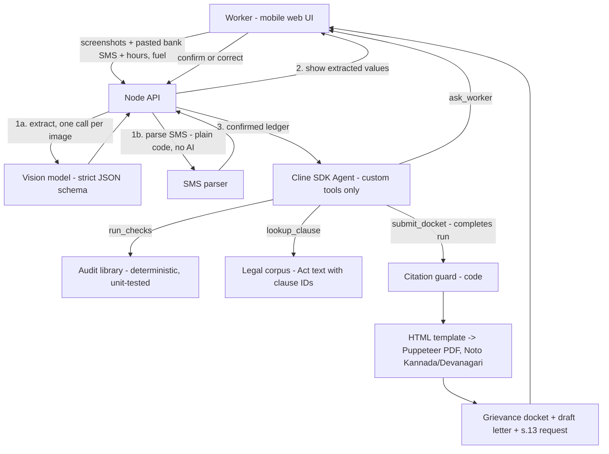

# Nyaya-Ledger

> Turn the payout screenshots and bank SMS a Karnataka gig worker already keeps into a checked, law-grounded grievance docket, ready to file on the state's grievance portal.

Built for the **Cline AI Builder Hackathon (Round 2)**. Cline was the coding partner for the whole build, and the **Cline SDK** (`@cline/sdk`) runs inside the product as the agent that runs the audit.

---

## The problem

India's gig workforce is large and growing. NITI Aayog estimated **7.7 million** gig workers in 2020-21 and projects **23.5 million by 2029-30**. In Karnataka alone, platforms reported close to **7 lakh** active gig workers to the state in April 2026 (with overlap across platforms).

These workers are paid, penalised and deactivated by systems they cannot inspect. In PAIGAM's 2024 survey of app-based workers (*Prisoners on Wheels?*, University of Pennsylvania, with IFAT), **83% of cab drivers and 87% of delivery workers** said ID blocking or deactivation affected them negatively.

Karnataka now has a law that addresses this directly. The **Karnataka Platform Based Gig Workers (Social Security and Welfare) Act, 2025** (in force from 30 May 2025) says:

| Section | What it gives the worker |
|---|---|
| s.15(1) | Reasons for any deduction must be stated **in the invoice**; payout must be made **as per the contract** |
| s.15(2) | Pay **at least weekly, with no delay** |
| s.14(2) | No termination or deactivation **without valid reasons in writing and 14 days' prior notice** (exception: cases of bodily harm, with a right to appeal) |
| s.13(1) | A procedure to **seek information** on the automated systems that affect fares and earnings |
| s.22(2) | A grievance about **payouts, deductions, termination** can be filed with the platform's **Internal Dispute Resolution Committee (IDRC)**, with escalation to the Welfare Board (s.22(5)) |

Since **1 May 2026**, workers can file these grievances through Karnataka's **Integrated Public Grievance Redressal System (IPGRS)**, which routes them to the platform's IDRC.

The rights and the filing channel exist. What's missing is the **evidence**. Workers already keep it, as screenshots of payouts, penalties and block notices and the bank SMS for every credit, but it sits scattered across their gallery and inbox and no one reconciles it by hand. This is **algorithmic information asymmetry**: the platform holds the data, and the worker holds a pile of screenshots.

## What Nyaya-Ledger does

A worker uploads the payout-statement and notice screenshots they already keep, **pastes their bank credit SMS**, and adds a few inputs (logged-in hours, fuel cost). Nyaya-Ledger:

1. **Reads** each screenshot into structured fields with a vision model, and **parses the SMS with plain code** (no AI sees the SMS). OTPs, debits and other messages are dropped automatically.
2. **Shows every extracted number back to the worker to confirm or correct** before anything is checked. A misread number must never become an accusation.
3. **Runs deterministic, unit-tested checks** on the confirmed data.
4. **Quotes the exact clause text** of the Act from a bundled copy.
5. **Drafts a grievance in Kannada, Hindi or English**, plus a s.13 information request.
6. Produces a **PDF evidence docket** for IPGRS / the IDRC: findings, arithmetic, screenshot references and the quoted clauses.

### What it does **not** claim

- It does **not** decide that a law was broken. Findings are worded as **"possible issue for review"**, with the arithmetic shown.
- It is **not legal advice**. Every docket says so.
- It does **not** check whether a platform paid the welfare fee. Under s.20(1) the fee is charged to the platform and paid to the state, which a worker's screenshots cannot show.
- It does **not** connect to any platform. Zomato, Swiggy and similar apps offer no partner data API. Scraping a worker's login would breach platform terms and could get the very account we're protecting blocked. The DPDP Act's right of access only starts on 13 May 2027. So all inputs come from the worker's own screenshots and SMS.
- It takes no position on the Act's validity. **The Act is under constitutional challenge in the Karnataka High Court** (IAMAI and platforms, citing conflict with the Code on Social Security, 2020). The court declined to stay it in July 2026. Every docket carries this note.

## The audit checks

Each check is a plain TypeScript function with unit tests. The agent calls them as tools; it never does the arithmetic itself.

| ID | Check | What it tests | Legal hook | Tier |
|---|---|---|---|---|
| C1 | Deduction reasons | Every deduction line has a stated reason. Labels like "Adjustment" or "Other" are flagged as **vague** (a judgement call, marked as such) | s.15(1) | Core |
| C2 | Statement arithmetic | Earnings − deductions = net payout, within ₹1 rounding; duplicate lines across overlapping screenshots removed by order ID | s.15(1) (payout as per contract); evidence for s.22(2) | Core |
| C3 | Deactivation notice | From a block/deactivation notice: was a written reason given? Was there ≥14 days between the notice and the effective date? | s.14(2) | Core |
| C4 | Payment cycle | Gap between consecutive payout dates (from statements and bank SMS) is at most 7 days | s.15(2) | Core |
| C5 | Real hourly earnings | (Net payout − fuel − optional upkeep) ÷ **logged-in hours** (including waiting time), shown next to gross ÷ hours | Context only, not a legal test | Core |
| C7 | Bank credit vs app | The platform credit in the bank SMS (dated 0-3 days after the week ends) equals the net payout the app showed | s.15(1), s.22(2) | Core |
| C6 | Incentive shortfall | Incentive the worker says was promised vs. amount paid. Flagged as "possible", because tier conditions are often not visible | s.15(1) | Stretch |

**Deliberately excluded:** a "welfare fee in the 1-5% range" check. The notified fee is **1% with a per-transaction cap** (₹0.50 for 2-wheeler food and grocery delivery), and it is charged to the platform, not the worker (s.20(1)). If a fee line *is* deducted from the worker, C1 shows it with a neutral note quoting s.20(1).

## Architecture



| Component | Role |
|---|---|
| Web UI (React + Vite) | Mobile-first: upload → confirm extracted numbers → findings → download docket. Language picker: ಕನ್ನಡ / हिन्दी / English |
| Extraction (`extract.ts`) | One vision call per screenshot, validated with a zod schema. Each value keeps its source image ID. Duplicate lines are removed by order ID |
| SMS parser (`sms.ts`) | Splits the pasted text into messages and keeps bank credits (amount, date, payer, reference). Skips OTPs and debits and says why. Credits whose payer doesn't match the platform are unticked by default. Tested on SBI, HDFC and Axis-style formats |
| Confirmation step | The worker sees each extracted value next to its screenshot or SMS and can edit it. Only confirmed data reaches the checks |
| Cline SDK agent (`agent.ts`) | Bare `Agent` with **only our custom tools** (no shell, file or web tools). Chooses which checks apply, asks the worker for missing inputs, writes plain-language explanations and the grievance letter in the chosen language, ends the run with `submit_docket` |
| Audit library (`server/audit/`) | C1-C5 and C7 (C6 if built) as pure functions with vitest tests, plus de-duplication of overlapping screenshots |
| Legal corpus (`legal/karnataka-2025.json`) | Clause ID → exact English text of s.12-15, 20-22 |
| Citation guard | Code check: every clause ID in the docket must exist in the corpus, and its quoted text is inserted from the corpus, not from the model. Fails closed |
| PDF | HTML rendered by headless Chromium (Puppeteer) so Kannada and Devanagari shape correctly |

### Why the agent is restricted

Screenshot and SMS text is **untrusted input**. A crafted screenshot or message could contain instructions. So the agent has no shell, file or network tools. It can only call five typed tools (`get_ledger_summary`, `run_checks`, `lookup_clause`, `ask_worker`, `submit_docket`), and the findings themselves come from code. The agent decides **what to do and how to explain it**, never **what the numbers are**.


## Guardrails

- **Worker confirms every number** before any check runs.
- **No invented citations.** The citation guard rejects any clause not in the corpus and inserts the clause text itself.
- **Evidence over verdicts.** Each finding shows inputs, arithmetic and screenshot references, worded as "possible issue for review".
- **Synthetic demo data**, stated clearly in the video.
- **Privacy.** Screenshots and SMS are held in memory for the session and not written to disk. Screenshots **are sent to a hosted vision model** for extraction. SMS are parsed by plain code on our server and never sent to an AI model. The UI asks the worker to crop out customer names, addresses and phone numbers before upload, and to paste only bank SMS.
- **Every docket** carries the "not legal advice" disclaimer and the pending-litigation note.

## Demo scenario

Ravi, a two-wheeler food-delivery partner in Bengaluru, uploads 4 synthetic screenshots (two overlapping weekly statements, one penalty screen, one ID-block notice) and pastes 5 SMS from his bank inbox (3 platform credits, 1 OTP, 1 fuel debit). He adds 52 logged-in hours and ₹1,450 fuel cost. Nyaya-Ledger finds:

- **2 deductions with only a vague label** ("Adjustment" ₹180, "Other" ₹95), totalling ₹275 (C1). A third deduction, a ₹150 late-delivery penalty with an order ID, passes.
- A **₹120 gap**: earnings ₹6,650 − deductions ₹425 = ₹6,225, but the net payout shown is ₹6,105 (C2)
- An **ID block notice with no reason given, effective the same day** it was sent (C3)
- The bank received **₹6,005 on 6 Oct, ₹100 less** than the ₹6,105 the app showed (C7)
- Payouts on 22 Sep, 29 Sep and 6 Oct, which is weekly as required (C4 OK). The OTP and fuel-debit SMS are skipped automatically
- **₹90/hour** after fuel (₹6,105 − ₹1,450 over 52 h), against ₹128/hour gross (C5)

It then produces a Kannada grievance letter and a PDF docket for IPGRS, plus a s.13 request asking how the "Adjustment" deduction was calculated.

<!-- Keep these numbers in sync with demo/data/*.json -->

## Tech stack

- **Runtime:** TypeScript on Node.js 22+
- **Agent:** `@cline/sdk` (`Agent`, `createTool`, zod tool schemas, `lifecycle.completesRun`)
- **Vision extraction:** a hosted vision-capable model (provider configured by env var), output validated with zod
- **Frontend:** React + Vite, mobile-first
- **Server:** Express + multer (in-memory uploads)
- **PDF:** HTML template → Puppeteer, with Noto Sans Kannada / Devanagari via `@fontsource`
- **Tests:** vitest for the audit library and citation guard

## Setup

Requires Node.js 22+.

```bash
git clone https://github.com/devanshjangid2005/nyaya-ledger.git
cd nyaya-ledger
cp .env.example .env      # set MODEL_PROVIDER, MODEL_ID, VISION_MODEL_ID, API_KEY
npm install
npm test                  # 22 tests: checks, SMS parser, citation guard, agent loop (stub model)
npm run smoke             # one real call to your model through the Cline SDK
npm run dev               # API on :8787, web on :5173
npm run demo              # runs the pipeline on demo/data without the UI
```

`MODEL_PROVIDER` is any Cline SDK built-in provider id (for example `anthropic`, `gemini`, `openrouter`, `openai-native`, `cline`).

### Project layout

```
shared/schema.ts            zod Ledger + Finding types
server/sms.ts               bank SMS parser (no AI)
server/audit/checks.ts      deterministic checks C1-C5, C7
server/audit/citations.ts   citation guard
server/agent.ts             Cline SDK agent (5 custom tools)
server/index.ts             Express API
legal/karnataka-2025.json   verbatim Act clauses
demo/data/                  synthetic demo ledger + SMS
web/                        React + Vite mobile UI
```

## How Cline was used

**In the build:** Cline scaffolded the project, wrote the audit library test-first (failing vitest tests before each check's implementation), built the zod extraction schema, the bundled legal corpus loader and citation guard, the React confirmation screen and the Puppeteer PDF template. <!-- Add 3-4 screenshots of real Cline prompts and diffs from the build -->

**Inside the product:** the Cline SDK `Agent` runs the audit. It reads the confirmed ledger, decides which checks apply (for example, C3 only when a block notice is present), asks the worker for missing inputs through an `ask_worker` tool, looks up clause text, writes the worker-facing explanation and grievance letter in Kannada, Hindi or English, and ends the run by calling `submit_docket`, whose citations are then checked in code.


## Limitations

- Karnataka only.
- Accuracy depends on screenshot quality; the confirmation step reduces but does not remove this.
- Cannot see platform-side data: incentive tier rules, what the platform reports to the state, or welfare-fee deposits.
- Statutory timelines are taken from the Act; the Karnataka Rules (2025) and IPGRS practice may differ, so the docket cites the Act.
- The Act's validity is pending before the Karnataka High Court.
- Not legal advice.

## Future scope

- Other states as their laws become operational (Rajasthan 2023, Telangana, Bihar) and the central Code on Social Security, 2020.
- Voice input in Kannada and Hindi.
- Union dashboard with anonymised, aggregated findings (for example, how often "Adjustment" deductions appear).
- On-device vision models so screenshots never leave the phone.
- Direct IPGRS submission if an official API becomes available.
- **Less manual collection:** an Android companion app that reads bank SMS (Google Play allows this only under its "SMS-based money management" exception, after review); screen-recording import (scroll once instead of many screenshots); bank-statement PDF import; Form 26AS/AIS yearly totals per platform.
- **Platform-side data when it becomes legally available:** DPDP access requests (from 13 May 2027) and a worker-level view of Karnataka's PWFVS (s.21(3)), once operational.

## References

- Karnataka Platform Based Gig Workers (Social Security and Welfare) Act, 2025 (s.12-15, 20-22): https://ascent-hr.com/wp-content/uploads/2025/09/KarnatakaGigWorkersAct2025.pdf
- Khaitan & Co summary of the Act and Rules (Nov 2025): https://www.khaitanco.com/sites/default/files/2025-11/ERGO%20-%20Karnataka%20Gig%20workers%20-%2027%20Nov%202025.pdf
- Welfare fee notification, 1% with caps (Feb 2026): https://thesouthfirst.com/karnataka/karnataka-notifies-welfare-fee-on-gig-platforms-to-be-monitored-by-state-government
- Fee collection from July 2026 and worker counts: https://www.thehindu.com/news/cities/bangalore/karnataka-gig-workers-welfare-fee-to-be-collected-from-aggregators-from-july/article70817169.ece
- Gig grievance redressal via IPGRS (May 2026): https://www.thehindu.com/news/national/what-is-karnatakas-new-gig-worker-grievance-system-explained/article70947029.ece
- Karnataka High Court declines stay (July 2026): https://www.medianama.com/2026/07/223-karnataka-hc-gig-workers-act-welfare-fee/
- PAIGAM (2024), *Prisoners on Wheels? Report on Working and Living Conditions of App-based Workers in India*: https://tgpwu.org/wp-content/uploads/2024/03/Report-Final-Print-1.pdf
- NITI Aayog gig workforce estimates: https://indbiz.gov.in/indias-gig-economy-to-have-23-5-million-workers-by-2029-30-niti-aayog/
- Cline SDK docs: https://docs.cline.bot/sdk
- Google Play SMS permission policy (SMS-based money management exception): https://support.google.com/googleplay/android-developer/answer/10208820
- DPDP Rules 2025 commencement dates: https://www.bitscore.in/tools/dpdp-commencement

